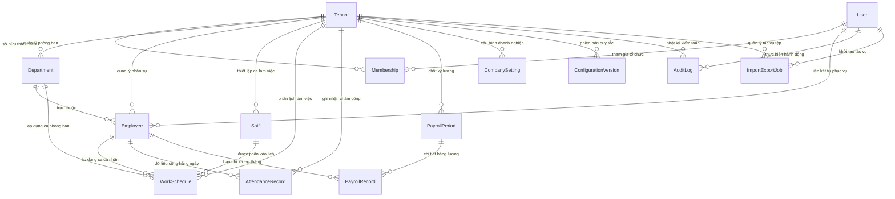

# THIẾT KẾ CƠ SỞ DỮ LIỆU VÀ LƯỢC ĐỒ PRISMA (DATA MODEL & PRISMA SCHEMA)

---

## 1. NGUYÊN TẮC THIẾT KẾ CƠ SỞ DỮ LIỆU ĐA DOANH NGHIỆP

Hệ thống cơ sở dữ liệu được thiết kế theo chuẩn **B2B SaaS Multi-tenant** đáp ứng các yêu cầu khắt khe về độ chính xác tài chính, bảo mật cô lập và khả năng mở rộng phục vụ hàng nghìn doanh nghiệp:

1. **Chuẩn hóa Multi-tenant (Discriminator Column `tenantId`):**
   - 100% các bảng dữ liệu nghiệp vụ (Phòng ban, Nhân viên, Ca làm việc, Phân lịch, Chấm công, Bảng lương, Cấu hình, Tác vụ tệp tin) đều bắt buộc có trường `tenantId` và ràng buộc khóa ngoại trỏ về bảng `Tenant`.
   - Cơ chế cascade: Khi một doanh nghiệp bị xóa khỏi hệ thống, toàn bộ dữ liệu phụ thuộc của doanh nghiệp đó sẽ được xóa dọn sạch sẽ (`onDelete: Cascade`), ngăn chặn tình trạng dữ liệu rác mồ côi (orphaned data).
2. **Khóa duy nhất có ngữ cảnh (Tenant-Scoped Unique Constraints):**
   - Các định danh nghiệp vụ như Mã nhân viên (`code`), Mã phòng ban (`code`), Mã ca làm việc (`code`), Kỳ tính lương (`yearMonth`) là duy nhất **trong phạm vi nội bộ của từng doanh nghiệp**, không phải duy nhất toàn cầu.
   - Ví dụ: Hai công ty khác nhau đều có thể có nhân viên mã `NV001` hoặc ca làm việc `HC` mà không bao giờ bị xung đột cơ sở dữ liệu (`@@unique([tenantId, code])`).
3. **Tính bất biến của Bảng lương (Payroll Snapshotting):**
   - Khi tính và chốt bảng lương (`PayrollRecord`), toàn bộ thông tin nhân sự (Họ tên, chức vụ, phòng ban), mức lương cơ bản, hệ số phụ cấp, đơn giá sản phẩm và kết quả chấm công được sao lưu thành bản chụp (snapshot) độc lập tại thời điểm đó.
   - Tuyệt đối không tính lương bằng cách JOIN động sang bảng nhân sự hiện tại, bởi vì thông tin chức vụ hoặc lương của nhân viên trong tương lai có thể thay đổi nhưng lịch sử lương quá khứ phải giữ nguyên 100%.
4. **Chiến lược tối ưu hóa chỉ mục (Compound Indexes):**
   - Mọi truy vấn trong hệ thống đều bắt đầu bằng điều kiện lọc `WHERE tenantId = ...`. Do đó, toàn bộ các chỉ mục tìm kiếm và sắp xếp đều được thiết kế dưới dạng chỉ mục phức hợp (Compound Index) với `tenantId` đứng đầu: `@@index([tenantId, status])`, `@@index([tenantId, yearMonth])`, `@@index([tenantId, departmentId])`.
5. **Lưu vết lịch sử cấu hình và kiểm toán (Auditing & Versioning):**
   - Mọi thay đổi về chính sách lương, thuế, bảo hiểm được lưu vết vào `ConfigurationVersion` kèm thời gian hiệu lực (`effectiveFrom`, `effectiveTo`).
   - Mọi hành vi tạo mới, cập nhật, xóa, khóa sổ kỳ lương được ghi nhận vào `AuditLog`.

---

## 2. LƯỢC ĐỒ THỰC THỂ QUAN HỆ (ERD - ENTITY RELATIONSHIP DIAGRAM)

---

## 3. DANH MỤC CÁC BẢNG DỮ LIỆU TRONG HỆ THỐNG

### 3.1. Phân hệ Tổ chức & Người dùng (Core Multi-Tenancy)

| Tên Bảng (Model) | Ý nghĩa nghiệp vụ | Khóa chính / Khóa ngoại | Ràng buộc duy nhất (Unique) & Chỉ mục (Indexes) |
| :--- | :--- | :--- | :--- |
| **`User`** | Tài khoản định danh toàn hệ thống Open SaaS (Email, mật khẩu, session). | `id` (UUID) | `@unique(email)`, `@unique(username)` |
| **`Tenant`** | Hồ sơ pháp nhân doanh nghiệp khách hàng (Tên, mã số thuế, địa chỉ, logo, gói cước). | `id` (UUID) | `@unique(slug)` |
| **`Membership`** | Liên kết người dùng với doanh nghiệp và vai trò cụ thể (`OWNER`, `ADMIN`, `ACCOUNTANT`, `HR_MANAGER`, `EMPLOYEE`). | `id` (UUID), `userId` $\rightarrow$ `User`, `tenantId` $\rightarrow$ `Tenant` | `@@unique([userId, tenantId])` `@@index([tenantId])` |

### 3.2. Phân hệ Nhân sự, Phòng ban & Phân ca (HR & Work Schedule)

| Tên Bảng (Model) | Ý nghĩa nghiệp vụ | Khóa chính / Khóa ngoại | Ràng buộc duy nhất (Unique) & Chỉ mục (Indexes) |
| :--- | :--- | :--- | :--- |
| **`Department`** | Phòng ban / Phân xưởng sản xuất trong doanh nghiệp. | `id` (UUID), `tenantId` $\rightarrow$ `Tenant` | `@@unique([tenantId, name])` `@@index([tenantId])` |
| **`Employee`** | Hồ sơ nhân viên, chức vụ, mức đãi ngộ, lương cơ bản, phụ cấp, tài khoản ngân hàng. | `id` (UUID), `tenantId` $\rightarrow$ `Tenant`, `departmentId` $\rightarrow$ `Department`, `userId?` $\rightarrow$ `User` | `@@unique([tenantId, code])` `@@index([tenantId, status])` `@@index([tenantId, departmentId])` |
| **`Shift`** | Định nghĩa ca làm việc: Ca hành chính, ca sáng, ca tối, giờ vào/ra, số công, hệ số tăng ca. | `id` (UUID), `tenantId` $\rightarrow$ `Tenant` | `@@unique([tenantId, code])` `@@index([tenantId, isActive])` |
| **`WorkSchedule`** | Lịch làm việc phân ca theo phòng ban hoặc từng cá nhân theo các ngày trong tuần. | `id` (UUID), `tenantId` $\rightarrow$ `Tenant`, `shiftId` $\rightarrow$ `Shift`, `departmentId?`, `employeeId?` | `@@index([tenantId, departmentId])` `@@index([tenantId, employeeId])` `@@index([tenantId, effectiveFrom])` |

### 3.3. Phân hệ Chấm công & Tính lương (Attendance & Payroll)

| Tên Bảng (Model) | Ý nghĩa nghiệp vụ | Khóa chính / Khóa ngoại | Ràng buộc duy nhất (Unique) & Chỉ mục (Indexes) |
| :--- | :--- | :--- | :--- |
| **`AttendanceRecord`** | Dữ liệu chấm công chi tiết từng ngày trong tháng của nhân viên (Mã công `X, N, CT, P, L, O, KP`, giờ OT). | `id` (UUID), `tenantId` $\rightarrow$ `Tenant`, `employeeId` $\rightarrow$ `Employee` | `@@unique([tenantId, employeeId, yearMonth, day])` `@@index([tenantId, yearMonth])` |
| **`PayrollPeriod`** | Quản lý kỳ tính lương tháng (Định dạng `YYYY-MM`), trạng thái khóa sổ (`DRAFT`, `REVIEWING`, `LOCKED`, `PAID`), tổng chi phí toàn công ty. | `id` (UUID), `tenantId` $\rightarrow$ `Tenant` | `@@unique([tenantId, yearMonth])` `@@index([tenantId, status])` |
| **`PayrollRecord`** | Bản chụp chi tiết bảng lương từng nhân viên trong kỳ (Snapshot lương thời gian, sản phẩm, OT, bảo hiểm 10.5%, chi phí NSDLĐ 23.5%, thuế TNCN, thực lĩnh Net). | `id` (UUID), `tenantId` $\rightarrow$ `Tenant`, `payrollPeriodId` $\rightarrow$ `PayrollPeriod`, `employeeId` $\rightarrow$ `Employee` | `@@unique([tenantId, payrollPeriodId, employeeId])` `@@index([tenantId, payrollPeriodId])` `@@index([tenantId, employeeId])` |

### 3.4. Phân hệ Cấu hình, Kiểm toán & Tác vụ tệp tin (Settings, Audit & Jobs)

| Tên Bảng (Model) | Ý nghĩa nghiệp vụ | Khóa chính / Khóa ngoại | Ràng buộc duy nhất (Unique) & Chỉ mục (Indexes) |
| :--- | :--- | :--- | :--- |
| **`CompanySetting`** | Tham số tính lương, ngày công chuẩn, tỷ lệ đóng bảo hiểm, mức giảm trừ thuế, tiêu đề người ký. | `id` (UUID), `tenantId` $\rightarrow$ `Tenant` (1-1) | `@unique(tenantId)` `@@index([tenantId])` |
| **`ConfigurationVersion`** | Lịch sử các phiên bản quy tắc cấu hình kèm kỳ hiệu lực (`effectiveFrom`, `effectiveTo`). | `id` (UUID), `tenantId` $\rightarrow$ `Tenant` | `@@index([tenantId, category, effectiveFrom])` |
| **`AuditLog`** | Nhật ký truy vết toàn bộ hành vi tạo, sửa, xóa, khóa sổ, mở khóa dữ liệu nhạy cảm. | `id` (UUID), `tenantId` $\rightarrow$ `Tenant`, `userId?` $\rightarrow$ `User` | `@@index([tenantId, entityType, createdAt])` `@@index([tenantId, userId])` |
| **`ImportExportJob`** | Hàng đợi quản lý tiến trình nhập file Excel chấm công và xuất báo cáo BHXH/Thuế. | `id` (UUID), `tenantId` $\rightarrow$ `Tenant`, `userId?` $\rightarrow$ `User` | `@@index([tenantId, type, status])` `@@index([tenantId, createdAt])` |

---

## 4. QUẢN LÝ DỮ LIỆU LỊCH SỬ VÀ BẤT BIẾN KHI KHÓA BẢNG LƯƠNG

Khi một kỳ lương chuyển trạng thái sang `LOCKED`:
1. **Đóng băng hồ sơ (Immutability):** Bảng `PayrollRecord` lưu trữ đầy đủ `baseSalary`, `insuranceSalaryBase`, `taxableIncome`, `netSalary` và các chỉ số công tại thời điểm đó.
2. **Ngăn chặn chỉnh sửa lén:** Tầng Data Access Layer chặn 100% mọi thao tác `UPDATE` hoặc `DELETE` trên `AttendanceRecord` và `PayrollRecord` của kỳ đã khóa.
3. **Mở khóa có kiểm soát (Emergency Unlock):** Chỉ duy nhất vai trò `OWNER` mới có thẩm quyền mở khóa bảng lương, và bắt buộc phải nhập lý do giải trình (tối thiểu 10 ký tự) để ghi nhận vào `AuditLog`.
