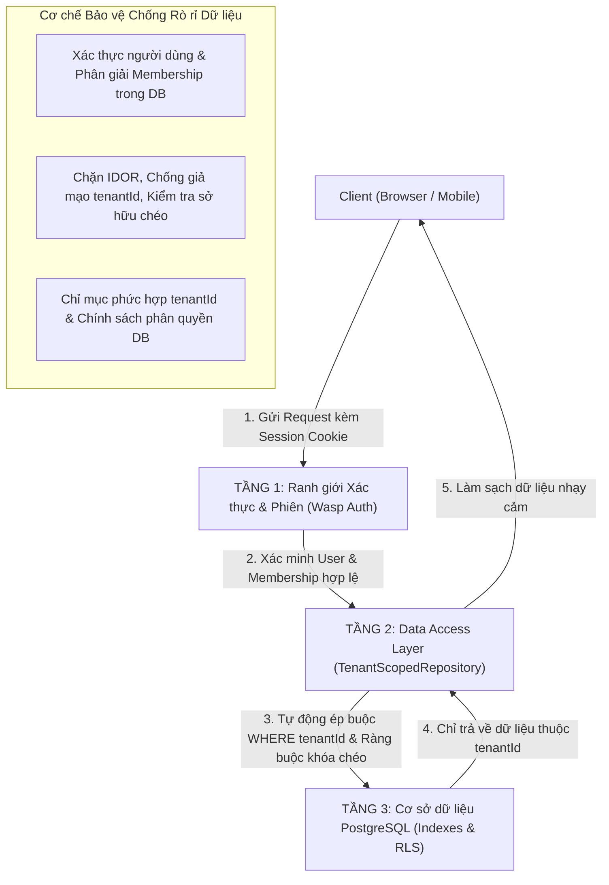

# THIẾT KẾ CÔ LẬP DỮ LIỆU ĐA DOANH NGHIỆP (MULTI-TENANT ARCHITECTURE)

---

## 1. MÔ HÌNH KIẾN TRÚC MULTI-TENANCY

Trong hệ thống B2B SaaS quản lý nhân sự và tính lương, việc bảo vệ dữ liệu giữa các doanh nghiệp khách hàng là ưu tiên số một. Hệ thống áp dụng mô hình **Shared Database, Shared Schema with Discriminator Column (`tenantId`)** kết hợp với chiến lược **Phòng thủ theo chiều sâu 3 tầng (3-Tier Defense-in-Depth)**.

### So sánh các phương án kiến trúc:

| Tiêu chí | Phương án 1: Database riêng (DB-per-Tenant) | Phương án 2: Schema riêng (Schema-per-Tenant) | Phương án 3 (Lựa chọn): Shared DB & Discriminator `tenantId` |
| :--- | :--- | :--- | :--- |
| **Mức độ cô lập dữ liệu** | Cô lập vật lý tuyệt đối | Cô lập mức schema logic | Cô lập mức bản ghi qua Tầng bảo vệ (Defense-in-Depth) |
| **Chi phí hạ tầng** | Cực kỳ tốn kém (Mỗi khách hàng 1 instance DB) | Trung bình (Tốn tài nguyên connection pool) | **Tối ưu chi phí nhất** (Toàn bộ khách hàng dùng chung 1 cụm PostgreSQL) |
| **Nâng cấp (Migrations)** | Phức tạp (Chạy lặp lại hàng trăm database) | Khó khăn (Prisma không hỗ trợ migrate động hàng trăm schema) | **Rất nhanh & an toàn** (Chạy `wasp db migrate-dev` 1 lần duy nhất) |
| **Tốc độ tạo doanh nghiệp** | Mất vài phút để khởi tạo DB | Mất 30 giây để tạo schema | **Tức thì (< 100ms)**: Tạo bản ghi trong bảng `Tenant` |
| **Khả năng tương thích** | Phải cấu hình router kết nối động | Phải cấu hình search_path phức tạp | **Tương thích 100%** với Wasp Framework và Prisma ORM |

---

## 2. KIẾN TRÚC PHÒNG THỦ THEO CHIỀU SÂU 3 TẦNG (3-TIER DEFENSE-IN-DEPTH)

### 2.1. Tầng 1: Ranh giới Xác thực & Phiên làm việc (Request Boundary)
- **Xác thực phiên (Wasp Auth):** Người dùng bắt buộc phải đăng nhập. Máy chủ giải mã cookie phiên an toàn để lấy `userId`.
- **Phân giải Doanh nghiệp (Membership Resolution):** Hệ thống truy vấn bảng `Membership` trong cơ sở dữ liệu dựa trên `userId` và `tenantId` đang thao tác:
  - Nếu người dùng KHÔNG thuộc doanh nghiệp này: Ném lỗi `HttpError(403, "Bạn không có quyền truy cập vào doanh nghiệp này.")`.
  - Nếu hợp lệ: Khởi tạo đối tượng `TenantContext` bất biến gồm `{ user, tenantId, role, membershipId }`.
- **Tuyệt đối không tin tưởng Client:** Bất kỳ tham số `tenantId` hay `role` nào do client gửi trong Request Body đều bị loại bỏ hoàn toàn.

### 2.2. Tầng 2: Data Access Layer (TenantScopedRepository)
- Toàn bộ thao tác nghiệp vụ bắt buộc phải đi qua lớp Repository có nhận `TenantContext`.
- **Chặn đứng lỗ hổng IDOR (Insecure Direct Object Reference):**
  - Khi người dùng gửi ID của một bản ghi (ví dụ: `employeeId`, `payrollPeriodId`, `jobId`), Repository kiểm tra `record.tenantId === context.tenantId`.
  - Nếu bản ghi thuộc doanh nghiệp khác, hệ thống ném lỗi `HttpError(403)` và không bao giờ để lộ sự tồn tại của dữ liệu.
- **Xác minh sở hữu quan hệ lồng nhau (Cross-Entity Ownership Validation):**
  - Khi tạo nhân viên mới gắn vào phòng ban `departmentId`: Hệ thống bắt buộc kiểm tra xem phòng ban đó có thuộc về cùng doanh nghiệp hay không.
  - Ngăn chặn kẻ xấu ở Công ty A gán phòng ban hoặc dữ liệu của Công ty B vào công ty mình.
- **Phân quyền theo vai trò (Role-Based Access Control):**
  - Nhân viên thường (`EMPLOYEE`): Chỉ được truy vấn và xem dữ liệu của chính mình (`emp.userId === context.user.id`).
  - Kế toán (`ACCOUNTANT`): Được xem bảng lương toàn công ty nhưng bị chặn không cho thay đổi danh mục phòng ban hay ca làm việc.
  - Quản trị viên (`ADMIN` / `OWNER`): Toàn quyền quản trị nhân sự và cấu hình doanh nghiệp.

### 2.3. Tầng 3: Cơ sở dữ liệu PostgreSQL & Đánh giá Row-Level Security (RLS)
- **Tối ưu hóa chỉ mục cô lập:** Toàn bộ bảng dữ liệu đều có chỉ mục bắt đầu bằng `tenantId`, đảm bảo PostgreSQL thực hiện Index Scan độc lập giữa các khách hàng, tốc độ truy vấn không bị suy giảm khi số lượng doanh nghiệp tăng cao.
- **Đánh giá thực tế về PostgreSQL Row-Level Security (RLS):**
  - Trong các ứng dụng Node.js/Prisma sử dụng Connection Pooler (như Supavisor / PgBouncer trên Supabase), ứng dụng kết nối tới DB bằng một tài khoản duy nhất (`postgres` hoặc superuser).
  - Mặc định, quyền superuser hoặc DB owner sẽ tự động bỏ qua (BYPASS) chính sách RLS.
  - Việc thiết lập `SET LOCAL app.current_tenant_id = ...` đòi hỏi phải mở transaction riêng cho từng câu lệnh truy vấn, có thể làm giảm hiệu năng và tiềm ẩn nguy cơ "rò rỉ ngữ cảnh" (context bleed) nếu connection pooling được dùng ở chế độ session/transaction.
  - **Kết luận kiến trúc:** **Tầng 2 (Data Access Layer ở Server)** là tuyến phòng thủ cốt lõi bắt buộc 100%. PostgreSQL RLS được cấu hình như một lớp bọc bảo vệ bổ sung (defense-in-depth) khi triển khai tài khoản DB chuyên dụng không phải superuser.

---

## 3. PHÂN BIỆT QUẢN TRỊ VIÊN TOÀN CỤC VS QUẢN TRỊ VIÊN DOANH NGHIỆP

| Tiêu chí | Quản trị viên Nền tảng SaaS (`User.isAdmin = true`) | Quản trị viên Doanh nghiệp (`TenantRole.OWNER / ADMIN`) |
| :--- | :--- | :--- |
| **Phạm vi quyền hạn** | Quản lý hóa đơn gói cước SaaS, xem thống kê hệ thống Open SaaS, quản lý hạ tầng máy chủ. | Toàn quyền quản lý nhân viên, ca kíp, bảng lương và cấu hình trong nội bộ doanh nghiệp của mình. |
| **Quyền truy cập dữ liệu lương** | **KHÔNG CÓ QUYỀN TRUY CẬP** vào bảng lương, bảng công hay thông tin nhân sự của khách hàng. | Được phép xem và phê duyệt bảng lương của doanh nghiệp mình. |
| **Hỗ trợ kỹ thuật (Impersonation)** | Khi cần hỗ trợ khách hàng, phải kích hoạt phiên hỗ trợ đặc biệt có thời hạn và bắt buộc ghi nhận lý do vào `AuditLog`. | Thao tác phục vụ hoạt động vận hành thường nhật của doanh nghiệp. |

---

## 4. MA TRẬN PHÂN QUYỀN NỘI BỘ (RBAC PERMISSIONS MATRIX)

| Hành động nghiệp vụ | OWNER | ADMIN | ACCOUNTANT | HR_MANAGER | EMPLOYEE |
| :--- | :---: | :---: | :---: | :---: | :---: |
| **Xem hồ sơ nhân sự toàn công ty** | ✅ | ✅ | ✅ | ✅ | ❌ (Chỉ xem của mình) |
| **Thêm / Sửa / Xóa nhân viên** | ✅ | ✅ | ❌ | ✅ | ❌ |
| **Thiết lập Ca làm & Lịch làm việc** | ✅ | ✅ | ❌ | ❌ | ❌ |
| **Chấm công hằng ngày** | ✅ | ✅ | ❌ | ✅ | ❌ |
| **Xem bảng lương toàn công ty** | ✅ | ✅ | ✅ | ❌ | ❌ (Chỉ xem phiếu cá nhân) |
| **Tính toán & Chốt bảng lương (LOCKED)** | ✅ | ❌ | ✅ | ❌ | ❌ |
| **Mở khóa bảng lương đã chốt (UNLOCK)** | ✅ | ❌ | ❌ | ❌ | ❌ |
| **Sửa cấu hình Nhóm A & Nhóm B** | ✅ | ❌ | ❌ | ❌ | ❌ |
| **Nhập / Xuất Excel báo cáo** | ✅ | ✅ | ✅ | ✅ | ❌ |

---

## 5. BẰNG CHỨNG KIỂM THỬ CÔ LẬP DỮ LIỆU ĐÃ XÁC MINH

Hệ thống đã triển khai bộ kiểm thử tích hợp tự động độc lập tại `template/app/src/payroll/server/multiTenantSecurity.test.ts` gồm 12 kịch bản an ninh:

1. **Test 1 - Chặn đọc chéo (IDOR Read):** User của Công ty Alpha dùng API đọc chi tiết nhân viên Công ty Beta $\rightarrow$ Bị chặn ném lỗi `HttpError(403)`.
2. **Test 2 - Chặn rò rỉ danh sách:** Truy vấn `listEmployees` của Công ty Alpha chỉ trả về đúng 4 nhân viên của Alpha, tuyệt đối không có nhân viên nào của Beta.
3. **Test 3 - Chặn đọc kỳ lương chéo:** Kế toán Công ty Alpha cố xem kỳ lương Công ty Beta $\rightarrow$ Bị chặn lỗi `HttpError(403)`.
4. **Test 4 - Chặn sửa chéo (IDOR Write):** Giám đốc Công ty Alpha cố sửa chức danh nhân viên Công ty Beta $\rightarrow$ Bị chặn lỗi `HttpError(403)`.
5. **Test 5 - Chặn chấm công chéo:** Kế toán Công ty Alpha cố sửa công của nhân sự Công ty Beta $\rightarrow$ Bị chặn lỗi `HttpError(403)`.
6. **Test 6 - Chặn tiêm phòng ban chéo:** Tạo nhân viên mới ở Công ty Alpha nhưng gán `departmentId` của Công ty Beta $\rightarrow$ Bị chặn lỗi `HttpError(403)`.
7. **Test 7 - Chống giả mạo tenantId từ client:** Client gửi kèm `tenantId` mạo danh trong payload $\rightarrow$ Hệ thống ép buộc dùng `tenantId` từ context đã xác thực.
8. **Test 8 - Giới hạn nhân viên thường:** Nhân viên thường (`EMPLOYEE`) gọi danh sách nhân sự $\rightarrow$ Chỉ nhận về đúng 1 bản ghi của chính họ.
9. **Test 9 - Chặn nhân viên xem đồng nghiệp:** Nhân viên thường cố xem hồ sơ Giám đốc $\rightarrow$ Bị chặn lỗi `HttpError(403)`.
10. **Test 10 - Chặn nhân viên tạo danh mục:** Nhân viên thường cố tạo phòng ban hoặc ca làm việc $\rightarrow$ Bị chặn lỗi `HttpError(403)`.
11. **Test 11 - Phân tách bảng lương:** Kế toán xem được bảng lương toàn công ty, nhân viên thường chỉ lấy được phiếu lương của chính mình.
12. **Test 12 - Cô lập file xuất Excel:** Tác vụ xuất file gắn chặt với `tenantId`, công ty khác cố truy cập link tải file $\rightarrow$ Bị chặn lỗi `HttpError(403)`.
