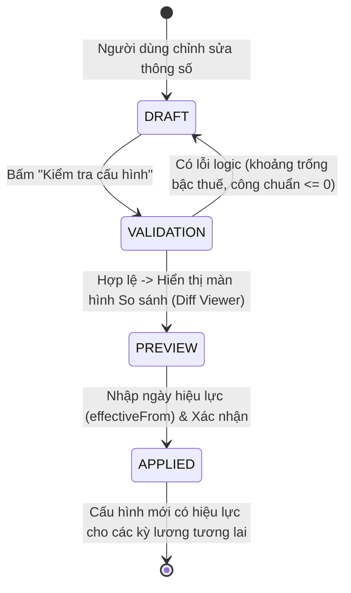

# DANH MỤC THIẾT LẬP VÀ VÒNG ĐỜI CẤU HÌNH (SETTINGS CATALOG & LIFECYCLE)

---

## 1. NGUYÊN TẮC THIẾT KẾ TRANG CÀI ĐẶT

Trang Cài đặt là trái tim vận hành của hệ thống SaaS, cho phép khách hàng tự thiết lập mọi chính sách nhân sự và công thức tính lương phù hợp với đặc thù doanh nghiệp mà **không cần can thiệp vào mã nguồn**.

### 4 Nguyên tắc cốt lõi:
1. **Thiết lập lần đầu nhanh chóng (Onboarding Wizard):** Cung cấp trình hướng dẫn 4 bước để doanh nghiệp mới có thể sẵn sàng vận hành chỉ sau 10 phút.
2. **Không phá vỡ dữ liệu lịch sử (Effective Dating & Versioning):** Mọi thay đổi về mức lương cơ sở, tỷ lệ đóng bảo hiểm hoặc biểu thuế đều phải gắn liền với **Ngày bắt đầu có hiệu lực (`effectiveFrom`)**. Các kỳ lương trong quá khứ đã khóa sổ tuyệt đối không bị tính toán lại ngầm.
3. **Quy trình 4 bước cho cấu hình nhạy cảm:** `Lưu nháp (Draft)` $\rightarrow$ `Kiểm tra tính hợp lệ (Validation)` $\rightarrow$ `Xem trước tác động (Preview)` $\rightarrow$ `Phê duyệt áp dụng (Apply)`.
4. **Phân quyền rành mạch:** Tách biệt cấu hình khách hàng tự quản lý (Nhóm A) và các quy tắc pháp lý/bảo mật cần kiểm soát (Nhóm B).

---

## 2. BỐ CỤC CÁC TAB CẤU HÌNH TRONG TRANG CÀI ĐẶT

```
┌──────────────────────────────────────────────────────────────────────────────────┐
│                             TRANG CÀI ĐẶT DOANH NGHIỆP                           │
├───────────────┬──────────────────────────────────────────────────────────────────┤
│ [Tab 1]       │ HỒ SƠ DOANH NGHIỆP: Tên pháp nhân, logo, MST, địa chỉ, hotline   │
│ [Tab 2]       │ PHÒNG BAN & CHỨC DANH: Quản lý cây phòng ban và danh mục chức vụ │
│ [Tab 3]       │ CHẤM CÔNG & CA LÀM: Công chuẩn, giờ công, ngày nghỉ tuần, hệ số OT│
│ [Tab 4]       │ PHỤ CẤP & SẢN PHẨM: Mức chuyên cần, thâm niên, đơn giá sản lượng │
│ [Tab 5]       │ THUẾ & BẢO HIỂM: Giảm trừ gia cảnh, biểu thuế 5/7 bậc, lương cơ sở│
│ [Tab 6]       │ THÀNH VIÊN & PHÂN QUYỀN: Mời người dùng, gán quyền Kế toán, HR   │
│ [Tab 7]       │ MẪU BIỂU & IN ẤN: Người ký biểu mẫu, tùy biến tiêu đề phiếu lương│
│ [Tab 8]       │ LỊCH SỬ & KIỂM TOÁN: Tra cứu các phiên bản cấu hình và nhật ký   │
└───────────────┴──────────────────────────────────────────────────────────────────┘
```

---

## 3. CHI TIẾT DANH MỤC THIẾT LẬP (SETTINGS CATALOG)

### Tab 1: Hồ sơ Doanh nghiệp & Nhận diện Thương hiệu (Nhóm A)
* **Tên công ty / Cửa hàng:** Tên đầy đủ trên giấy phép kinh doanh.
* **Mã số thuế doanh nghiệp (MST):** Dùng để in hóa đơn và báo cáo thuế.
* **Địa chỉ trụ sở:** Hiển thị trên phần đầu của bảng lương và phiếu lương in ấn.
* **Thông tin liên hệ:** Số điện thoại hotline, email phòng kế toán, website.
* **Logo công ty:** Tải file ảnh lên (PNG, JPG, SVG). Hệ thống tự động thu nhỏ kích thước tối ưu và hiển thị trên bản in phiếu lương chuẩn.

### Tab 2: Phòng ban & Chức vụ (Nhóm A)
* **Danh sách phòng ban:** Thêm, sửa, xóa phòng ban (ví dụ: Ban Giám đốc, Kế toán, Kinh doanh, Nhân sự, Kho vận, Sản xuất).
* **Danh mục chức vụ:** Giám đốc, Kế toán trưởng, Nhân viên kinh doanh, Công nhân, Thủ kho...

### Tab 3: Quy tắc Chấm công & Ngày làm việc (Nhóm A)
* **Công chuẩn trong tháng:** Mặc định `26` ngày (cho phép tùy chỉnh thành 24, 25, 27 ngày theo quy chế công ty).
* **Số giờ / công chuẩn:** Mặc định `8` giờ/ngày.
* **Ngày nghỉ hàng tuần:** 
  * Lựa chọn 1: `Chủ nhật` (Nghỉ 1 ngày/tuần $\rightarrow$ 26 ngày công).
  * Lựa chọn 2: `Thứ 7 và Chủ nhật` (Nghỉ 2 ngày/tuần $\rightarrow$ 22 ngày công hành chính).
* **Hệ số làm thêm giờ (OT):**
  * Ngày làm việc thông thường: Mặc định `1.5` (150%).
  * Ngày nghỉ hàng tuần: Mặc định `2.0` (200%).
  * Ngày lễ, Tết, ngày nghỉ có hưởng lương: Mặc định `3.0` (300%).
* **Điều kiện hưởng phụ cấp chuyên cần:** Số ngày nghỉ tối đa trong tháng (`maxAllowedUnpaidDays`, mặc định `0`). Nếu tổng ngày nghỉ không lương và nghỉ ốm vượt quá ngưỡng này, hệ thống tự động cắt phụ cấp chuyên cần.

### Tab 4: Danh mục Phụ cấp & Lương Sản phẩm (Nhóm A)
* **Phụ cấp ăn trưa / ăn ca không chịu thuế:** Mức trần theo quy định hiện hành (tối đa 730.000 đ/tháng).
* **Phụ cấp xăng xe / điện thoại:** Cấu hình mức hưởng mặc định theo chức vụ.
* **Đơn giá lương sản phẩm mặc định:** Đơn giá VNĐ / 1 đơn vị sản phẩm (dành cho bộ phận sản xuất/gia công).

### Tab 5: Tham số Thuế TNCN & Bảo hiểm Bắt buộc (Nhóm B - Có kiểm soát)
* **Giảm trừ gia cảnh thuế TNCN:**
  * Giảm trừ bản thân: Cấu hình mặc định theo luật áp dụng (15.500.000 đ/tháng cho kỳ thuế từ 2026; 11.000.000 đ/tháng cho các kỳ thuế trước 2026).
  * Giảm trừ người phụ thuộc: 6.200.000 đ/người/tháng (từ 2026) hoặc 4.400.000 đ/người/tháng (cũ).
* **Biểu thuế suất lũy tiến từng phần:**
  * Biểu 5 bậc mới (từ 2026): 5%, 10%, 20%, 30%, 35%.
  * Biểu 7 bậc truyền thống: 5%, 10%, 15%, 20%, 25%, 30%, 35%.
* **Mức lương cơ sở trần BHXH, BHYT:** 2.530.000 đ (từ 01/07/2026) hoặc 2.340.000 đ (trước 07/2026). Trần tối đa $= 20$ lần.
* **Mức lương tối thiểu vùng I trần BHTN:** 5.310.000 đ (từ 2026) hoặc 4.960.000 đ (cũ). Trần tối đa $= 20$ lần.
* **Tỷ lệ trích nộp bảo hiểm bắt buộc:**
  * Người lao động: BHXH (8%), BHYT (1.5%), BHTN (1%).
  * Doanh nghiệp: BHXH (17.5%), BHYT (3%), BHTN (1%), Kinh phí công đoàn (2%).

### Tab 6: Thành viên & Phân quyền Vai trò (Nhóm A & Nhóm B)
* Mời thành viên mới tham gia qua Email: Người nhận bấm link xác nhận để vào công ty.
* Gán vai trò cho thành viên: `ADMIN`, `ACCOUNTANT`, `HR_MANAGER`, `EMPLOYEE`.
* Thu hồi quyền truy cập hoặc xóa thành viên khỏi doanh nghiệp.

### Tab 7: Mẫu Biểu In ấn & Người ký duyệt (Nhóm A)
* Tùy chỉnh danh xưng người ký dưới chân bảng lương và phiếu lương:
  * Chức danh người lập: Mặc định *"Người lập biểu"*.
  * Chức danh kế toán: Mặc định *"Kế toán trưởng"*.
  * Chức danh người duyệt: Mặc định *"Giám đốc"*.
* Lời nhắc chân trang phiếu lương (Disclaimer): Tùy chỉnh văn bản quy định thời hạn khiếu nại phiếu lương (mặc định 03 ngày).

---

## 4. QUY TRÌNH THIẾT LẬP LẦN ĐẦU CHO KHÁCH HÀNG MỚI (ONBOARDING WIZARD)

Khi một khách hàng doanh nghiệp vừa tạo tài khoản, hệ thống hiển thị thanh tiến trình 4 bước trực quan:

```
┌────────────────────────────────────────────────────────────────────────────────────────┐
│                        TRÌNH HƯỚNG DẪN KHỞI TẠO DOANH NGHIỆP (4 BƯỚC)                  │
├─────────────────┬─────────────────┬─────────────────────────┬──────────────────────────┤
│ BƯỚC 1:         │ BƯỚC 2:         │ BƯỚC 3:                 │ BƯỚC 4:                  │
│ Thông tin Cty   │ Phòng ban & Ca  │ Chính sách Thuế & BH    │ Nhập danh sách nhân sự   │
│ - Tên pháp nhân │ - Chọn phòng ban│ - Xác nhận biểu thuế    │ - Tải file Excel mẫu     │
│ - Tải logo      │ - Công chuẩn 26 │ - Xác nhận giảm trừ     │ - Bấm nhập danh sách     │
│ - Mã số thuế    │ - Nghỉ Chủ nhật │ - Tỷ lệ bảo hiểm chuẩn  │ - Hoàn tất & sẵn sàng!   │
└─────────────────┴─────────────────┴─────────────────────────┴──────────────────────────┘
```

---

## 5. VÒNG ĐỜI QUẢN LÝ THAY ĐỔI CẤU HÌNH (CONFIGURATION LIFECYCLE)

Để ngăn ngừa lỗi do kế toán thay đổi cài đặt làm sai lệch bảng lương của các tháng trước, hệ thống triển khai vòng đời quản lý cấu hình nghiêm ngặt:



1. **Lưu nháp (Draft State):** Các thay đổi chưa tác động ngay vào cơ sở dữ liệu vận hành.
2. **Kiểm tra tính hợp lệ (Validation Engine):**
   * Kiểm tra công chuẩn phải nằm trong khoảng $20 \le \text{công} \le 31$.
   * Kiểm tra các bậc thuế suất lũy tiến phải liên tục, không có khoảng hở và bậc cuối cùng phải mở (không giới hạn).
   * Kiểm tra tỷ lệ bảo hiểm không được là số âm.
3. **Xem trước tác động (Preview & Diff Analysis):**
   * Hệ thống hiển thị rõ: *"Thay đổi này sẽ bắt đầu có hiệu lực từ kỳ lương Tháng MM/YYYY. Có 0 kỳ lương trong tương lai sẽ áp dụng công thức mới. Toàn bộ các kỳ lương đã khóa trong quá khứ được giữ nguyên 100%."*
4. **Áp dụng (Apply with Effective Date):**
   * Tạo bản ghi mới trong bảng `ConfigurationVersion`.
   * Ghi nhận vào `AuditLog` danh tính người duyệt và lý do thay đổi.
