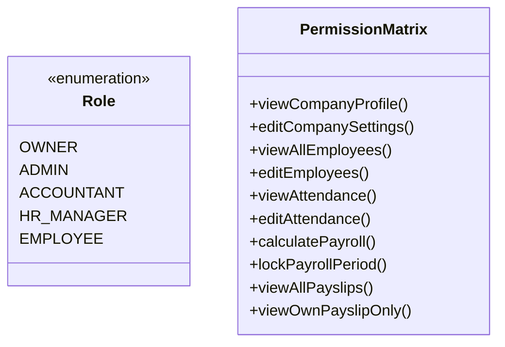

# THIẾT KẾ KIẾN TRÚC HỆ THỐNG TỔNG THỂ (SYSTEM ARCHITECTURE DOCUMENT)

---

## 1. PHONG CÁCH KIẾN TRÚC (ARCHITECTURAL STYLE)

Hệ thống được thiết kế theo phong cách **Modular Monolith (Nguyên khối phân rã Module)** trên nền tảng **Wasp Framework (v0.26.1)**. 

### Rationale (Lý do lựa chọn kiến trúc):
1. **Phù hợp với Open SaaS:** Open SaaS được tối ưu hóa để vận hành như một Modular Monolith, tận dụng cơ chế Type-Safe giữa Frontend và Backend tự động của Wasp.
2. **Loại bỏ độ trễ và phức tạp của Microservices:** Trong các hệ thống tính lương nhân sự, tính toàn vẹn của giao dịch cơ sở dữ liệu (ACID Transaction) là sống còn. Một Modular Monolith cho phép thực hiện việc khóa kỳ lương, tính lương và ghi nhận nhật ký kiểm toán trong cùng một Database Transaction an toàn tuyệt đối.
3. **Dễ đóng gói và triển khai:** Toàn bộ ứng dụng có thể đóng gói thành một Docker Container duy nhất, dễ dàng triển khai trên VPS, Railway, Fly.io, hoặc hạ tầng riêng của khách hàng doanh nghiệp khi cần.

---

## 2. KIẾN TRÚC PHÂN TẦNG CHI TIẾT (LAYERED ARCHITECTURE)

```
┌────────────────────────────────────────────────────────────────────────────────────────┐
│                                   TẦNG GIAO DIỆN (PRESENTATION LAYER)                  │
│  - React 19 + TypeScript + Vite 8 + TailwindCSS v4                                     │
│  - Shadcn UI (Radix Primitives: Dialog, Select, Dropdown, Form, Sheet, Toast...)       │
│  - ApexCharts (Biểu đồ quỹ lương, chi phí nhân sự, xu hướng 12 tháng)                 │
│  - Lưới chấm công tương tác (Interactive Attendance Grid & Brush Tool)                 │
│  - Bảng lương sửa trực tiếp (Inline Editable Payroll Spreadsheet Component)            │
└────────────────────────────────────────────────────────────────────────────────────────┘
                                            │
                                            ▼ (HTTP / RPC via Wasp Operations)
┌────────────────────────────────────────────────────────────────────────────────────────┐
│                              TẦNG ĐIỀU PHỐI & BẢO MẬT (API & OPERATION LAYER)          │
│  - Wasp Router & Route Guards (authRequired: true)                                     │
│  - Wasp Auth Middleware (Session / Cookie Verification -> context.user)                │
│  - Tenant Context Interceptor (Xác định Active Tenant -> context.tenantId)             │
│  - RBAC Policy Guard (Kiểm tra quyền Role: OWNER, ADMIN, ACCOUNTANT, HR, EMPLOYEE)     │
└────────────────────────────────────────────────────────────────────────────────────────┘
                                            │
                                            ▼
┌────────────────────────────────────────────────────────────────────────────────────────┐
│                             TẦNG NGHIỆP VỤ MIỀN (DOMAIN SERVICES LAYER)               │
│                                                                                        │
│  ┌──────────────────────┐  ┌──────────────────────┐  ┌──────────────────────────────┐  │
│  │ Organization Service │  │  HR & Employee Svc   │  │   Timekeeping Service        │  │
│  │ - Tenant creation    │  │  - Master CRUD       │  │   - Grid state machine       │  │
│  │ - Membership & Roles │  │  - Excel auto-parser │  │   - Work day & OT summary    │  │
│  └──────────────────────┘  └──────────────────────┘  └──────────────────────────────┘  │
│  ┌──────────────────────┐  ┌──────────────────────┐  ┌──────────────────────────────┐  │
│  │ Payroll Engine Svc   │  │ Tax & Insurance Svc  │  │   Document & Export Service  │  │
│  │ - Gross-to-Net math  │  │ - PIT 5/7 bracket    │  │   - Multi-sheet Excel (.xlsx)│  │
│  │ - Piece-rate & Bonus │  │ - 14-day rule engine │  │   - Printable HTML payslip   │  │
│  │ - Period lock guard  │  │ - Effective dating   │  │   - Vietnamese docSo engine  │  │
│  └──────────────────────┘  └──────────────────────┘  └──────────────────────────────┘  │
│  ┌──────────────────────────────────────────────────────────────────────────────────┐  │
│  │ Audit & Compliance Service: Ghi nhật ký kiểm toán không thể sửa xóa (Audit Log) │  │
│  └──────────────────────────────────────────────────────────────────────────────────┘  │
└────────────────────────────────────────────────────────────────────────────────────────┘
                                            │
                                            ▼
┌────────────────────────────────────────────────────────────────────────────────────────┐
│                               TẦNG TRUY XUẤT DỮ LIỆU (DATA ACCESS LAYER)               │
│  - Prisma ORM 5.19 Client                                                              │
│  - Multi-tenant Prisma Extension: Tự động đính kèm `where: { tenantId }`               │
│  - Database Transaction Coordinator (`prisma.$transaction`)                            │
└────────────────────────────────────────────────────────────────────────────────────────┘
                                            │
                         ┌──────────────────┴──────────────────┐
                         ▼                                     ▼
┌──────────────────────────────────────────────┐  ┌──────────────────────────────────────┐
│       HẠ TẦNG DỮ LIỆU (DATABASE INFRA)       │  │      LƯU TRỮ TỆP (STORAGE INFRA)     │
│  - Supabase PostgreSQL (hoặc self-hosted PG)  │  │  - Supabase Storage (S3-Compatible)  │
│  - Schema: Business Tables & Prisma Models   │  │  - Logo doanh nghiệp, file đính kèm   │
│  - PgBoss: Hàng đợi tác vụ ngầm & Cron Jobs  │  │  - Chữ ký số, tệp backup JSON/Excel  │
└──────────────────────────────────────────────┘  └──────────────────────────────────────┘
```

---

## 3. KIẾN TRÚC BẢO MẬT & KIỂM SOÁT TRUY CẬP (SECURITY ARCHITECTURE)

### 3.1. Xác thực (Authentication)
* Hệ thống tận dụng trọn vẹn **Wasp Auth**:
  * Lưu trữ thông tin đăng nhập an toàn (băm mật khẩu bằng `bcrypt`).
  * Quản lý phiên làm việc bằng HttpOnly Secure Cookies để chống tấn công XSS.
  * Hỗ trợ xác thực qua Email Token và Google OAuth 2.0.

### 3.2. Ngữ cảnh đa doanh nghiệp (Tenant Context Resolution)
Mỗi request gửi từ Client lên Server đều được giải quyết ngữ cảnh theo luồng chuẩn:
1. `context.user` được xác thực bởi Wasp Auth.
2. Từ `user.id`, hệ thống truy vấn bảng `Membership` để lấy danh sách công ty người dùng thuộc về.
3. Người dùng chọn công ty làm việc hiện tại $\rightarrow$ `activeTenantId` được lưu trong session hoặc gửi kèm header `X-Tenant-Id`.
4. Máy chủ kiểm tra quyền của `user.id` trong `activeTenantId`:
   * Nếu hợp lệ $\rightarrow$ gắn `context.tenantId = activeTenantId` và `context.role = membership.role`.
   * Nếu không hợp lệ $\rightarrow$ chặn đứng lập tức với lỗi `HttpError(403)`.

### 3.3. Phân quyền vai trò (Role-Based Access Control - RBAC)



* **OWNER (Chủ doanh nghiệp):** Toàn quyền cấu hình công ty, quản lý thành viên, xem toàn bộ lương và phê duyệt khóa kỳ lương.
* **ADMIN (Quản trị viên công ty):** Quản lý nhân sự, chấm công, cấu hình ca kíp, mời thành viên; không thể xóa tổ chức.
* **ACCOUNTANT (Kế toán tiền lương):** Nhập số liệu phát sinh (thưởng, sản lượng, tạm ứng), tính lương, in phiếu lương, xuất báo cáo tài chính; không sửa cấu hình nhân sự.
* **HR_MANAGER (Chuyên viên Nhân sự/Chấm công):** Chấm công hàng ngày, nhập danh sách nhân viên từ Excel, quản lý phép/nghỉ; không xem được số tiền lương chi tiết của nhân viên nếu không được phân quyền.
* **EMPLOYEE (Nhân viên thông thường):** Chỉ xem được ngày công cá nhân và phiếu lương của chính mình thông qua Cổng tự phục vụ (Self-Service).

---

## 4. QUẢN LÝ TÍNH TOÀN VẸN CỦA ĐỘNG CƠ TÍNH LƯƠNG (PAYROLL INTEGRITY)

Để đảm bảo tính toán luôn chính xác và có thể tái lập (deterministic), động cơ tính lương được thiết kế theo nguyên lý **Hàm Thuần Túy (Pure Function Service)**:

1. **Đầu vào (Input Parameters):**
   * Thông tin nhân viên (Lương CB, Lương BH, Phụ cấp...).
   * Tổng hợp công tháng (Ngày công làm, ngày phép, lễ, nghỉ không lương, giờ OT).
   * Số liệu phát sinh trong tháng (Sản lượng, thưởng, tạm ứng, khấu trừ).
   * Snapshot cấu hình thời điểm đó (Công chuẩn, biểu thuế, tỷ lệ bảo hiểm, trần đóng).
2. **Xử lý (Processing):**
   * Không thực hiện bất kỳ lệnh gọi I/O hoặc truy vấn database nào bên trong vòng lặp tính toán.
   * Tính toán tuần tự, kiểm tra điều kiện miễn trừ 14 ngày, áp dụng trần BHXH/BHTN, tính thuế lũy tiến.
   * Làm tròn số tiền VND ở từng khoản mục bằng `Math.round()`.
3. **Đầu ra (Output Snapshot):**
   * Trả về đối tượng `PayrollRecord` chứa đầy đủ chi tiết từng khoản mục thu nhập và khấu trừ.
   * Khi kỳ lương được **Khóa (LOCKED)**, toàn bộ bản ghi này được lưu cứng (snapshot) vào bảng `SalarySlip` trong database. Bất kỳ thay đổi nào sau đó về lương cơ bản trong hồ sơ nhân sự cũng **không làm thay đổi** số liệu đã chốt.

---

## 5. CHIẾN LƯỢC TÍCH HỢP SUPABASE (SUPABASE INTEGRATION STRATEGY)

* **Supabase PostgreSQL:**
  * Kết nối trực tiếp qua `DATABASE_URL` trong file `.env.server`.
  * Wasp sử dụng Prisma để tự động sinh mã SQL và quản lý migrations (`wasp db migrate-dev`).
  * Tận dụng tính năng sao lưu hàng ngày (Daily Automatic Backup) và Point-in-time Recovery của Supabase.
* **Supabase Storage (Tệp tin & Tài liệu):**
  * Thiết lập một Storage Bucket tên là `payroll-tenant-assets` với chính sách Private Access.
  * Tái sử dụng nguyên vẹn `@aws-sdk/client-s3` có sẵn trong Open SaaS.
  * Khi client cần tải file lên hoặc xem logo, Server sinh một Presigned URL có thời hạn (ví dụ: 15 phút) để bảo mật tuyệt đối.
